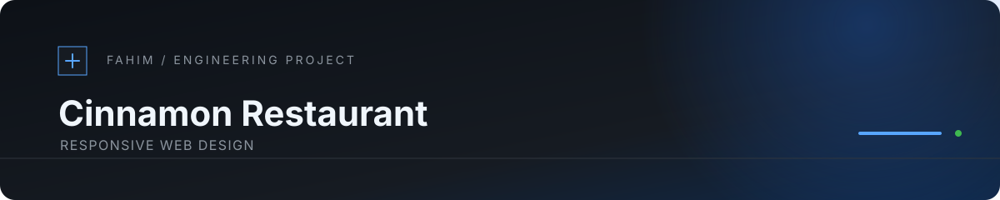

[Social preview SVG source · 1280 × 640](./assets/brand/social-preview.svg)

# Cinnamon Restaurant & Party Center — Website Concept

A responsive restaurant website concept built with HTML, CSS, and vanilla JavaScript. The project focuses on presenting restaurant information, browsing a menu and gallery, using mobile navigation, and preparing a reservation request.

**Live demo:** [Open Cinnamon Restaurant website](https://cinnamon-restaurant-concept.onrender.com)

**Repository:** https://github.com/fahim1252375-maker/restaurant-website-frontend

## Features

- Responsive page layout and mobile navigation
- Restaurant introduction and service sections
- Menu category filtering
- Image gallery and interface animations
- Reservation form validation
- WhatsApp link with a pre-filled reservation message
- SEO metadata and Restaurant structured data

## Technologies

- HTML5
- CSS3
- Vanilla JavaScript

## Run Locally

From a terminal:

~~~bash
git clone https://github.com/fahim1252375-maker/restaurant-website-frontend.git
cd restaurant-website-frontend
python3 -m http.server 8000
~~~

Then open http://localhost:8000.

## Reservation Flow

Submitting the form prepares a message and opens WhatsApp. It does not save a booking to a database or confirm a reservation. The restaurant still needs to reply and confirm availability.

## Before Using This for a Real Restaurant

This is a portfolio concept, not an approved business website. Confirm the restaurant's permission and verify its address, phone number, menu, prices, opening hours, and social links before publishing it for a real business. Also verify image usage rights and remove any sample or unverified ratings and review counts.

## AI Use Disclosure

AI tools may be used as supporting aids for brainstorming, explaining concepts, debugging, and drafting documentation. The project author is responsible for reviewing, adapting, understanding, and testing published work. AI suggestions are not treated as verified results unless checked against the actual implementation.

---

Built by MD. Minhazur Rahman Fahim as a frontend portfolio project.
